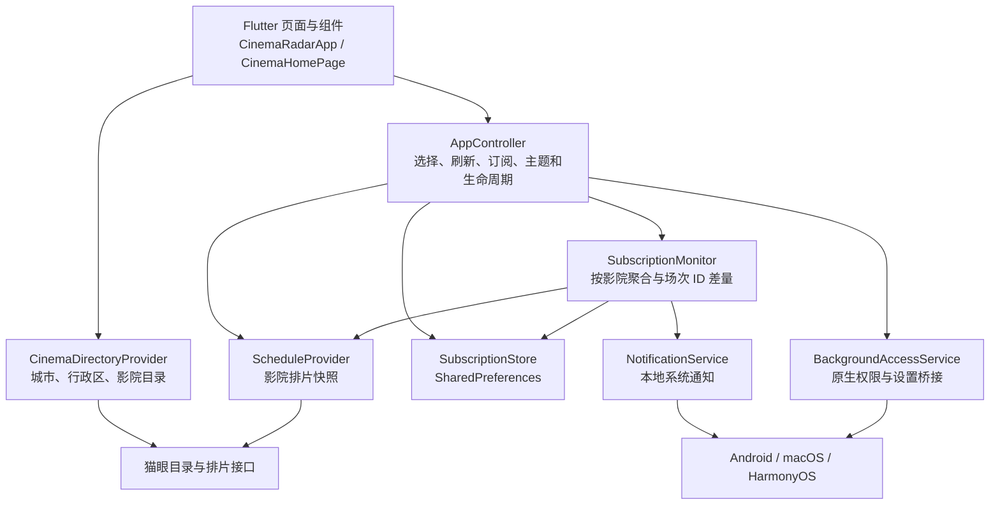
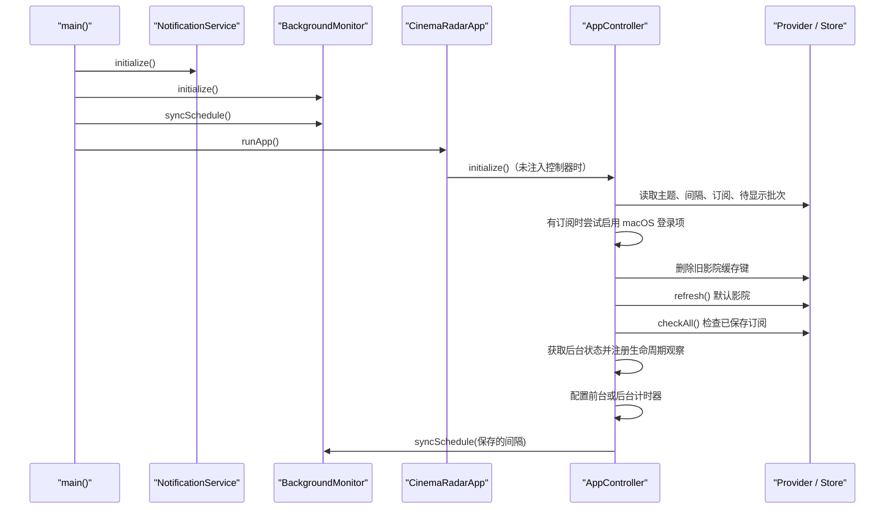
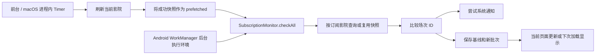

# 02 · 系统架构与执行链路

源码入口：[main](../lib/main.dart)、[AppController](../lib/app_controller.dart)、[订阅检测](../lib/services/subscription_monitor.dart)。

## 1. 总体分层

应用由展示层、状态控制层、数据/业务服务层、端侧存储和原生平台桥接组成。分层是对现有文件职责的归纳；项目没有引入完整的 Clean Architecture 框架、依赖注入容器或 BLoC。

影院搜索组件直接依赖 `CinemaDirectoryProvider`，不通过 `AppController`。这是现有架构的一个有意简化：目录加载属于弹窗局部交互，排片与订阅属于主页面共享状态。

## 2. 主要依赖边界

| 层/对象 | 对外职责 | 不承担的职责 |
| --- | --- | --- |
| Flutter Widgets | 展示、用户输入、导航、局部展开和筛选状态 | 实现 HTTP 报文解析 |
| `AppController` | 组织主页面用例并通知视图更新 | 决定外部票务平台如何锁座 |
| `ScheduleProvider` | 将指定影院映射为快照 | 管理通知权限和 UI |
| `CinemaDirectoryProvider` | 查询地域与影院 | 保存用户浏览历史 |
| `SubscriptionMonitor` | 聚合查询、ID 差量、保存基线与提醒 | 管理 UI 计时器 |
| `SubscriptionStore` | JSON 与 SharedPreferences 读写 | 跨进程事务与行锁 |
| `BackgroundMonitor` | 注册/取消 Android 周期任务 | 直接显示排片组件 |
| 原生桥接 | 查询可获得的系统状态，打开设置 | 保证系统永不结束应用 |

模型位于 `domain/models.dart`，但模型工厂仍直接解析猫眼字段，如 `fromMaoyan`。因此“更换数据源不改 UI”已有接口基础，“领域模型完全不感知数据源”尚未完全做到。

## 3. 启动顺序

`main()` 在 `runApp` 前等待通知插件和 Android 调度初始化。它没有顶层恢复界面；若这些初始化发生未捕获异常，可能阻止应用进入首屏。控制器的 `initialize()` 在 Widget 中被触发但没有由页面 `await`，后续异常也没有统一启动错误状态。

Android 调度在启动入口和控制器初始化后各同步一次：前一次调用未显式传间隔，默认 15 分钟；后一次用保存的间隔替换。该行为不代表存在两个不同名字的后台任务，二者使用相同唯一任务名。

## 4. 状态归属

### 全局业务状态

`AppController` 管理当前影院、快照、选中影片、订阅集合、加载状态、错误、主题、刷新间隔、权限状态和提醒批次。

### 组件局部状态

- 搜索弹窗：地域选择、目录加载、搜索文本、候选影院。
- 排片面板：排序方向和影厅筛选条件。
- 顶部提醒：展开/收起。
- Flutter 导航栈：Dialog、SearchDelegate、BottomSheet 和侧边栏显示。

### 持久化状态

只将订阅、主题、刷新间隔和当前提醒批次写入 SharedPreferences。当前浏览影院、选择影片、排序筛选和展开状态不保存到磁盘。

## 5. 两种检测执行环境

前台控制器和 Android 后台任务共享检测类，但不是共享内存中的同一个控制器。Worker 不会调用页面的 `notifyListeners()`；页面需要之后读取存储才能看到后台结果。

## 6. 控制反转与测试接缝

- `AppController(provider:, store:)` 支持注入固定排片 Provider。
- `MaoyanScheduleProvider(client:)` 与目录 Provider 支持注入 `http.Client`。
- `SubscriptionMonitor(provider:, store:, notifications:)` 有可替换的构造参数。
- `CinemaHomePage(directoryProvider:)` 支持替换目录来源。
- `CinemaRadarApp(controller:, home:)` 支持不启动真实数据加载的测试页面。

这些接缝足以覆盖部分解析和 Widget 行为，但通知服务的单例/私有构造、计时器和系统调度还不是独立接口，进一步做完整业务单元测试需要补充抽象。

## 7. 为什么使用端侧架构

当前业务仅需小规模地域查询和个人订阅比较。端侧方式部署简单，避免为每台手机维护本机后端，也不集中收集订阅偏好。

代价同样明确：每台设备独立消耗外部接口请求；后台执行受平台约束；没有统一推送；本地状态一致性和数据源变化需要客户端升级处理。若将来需要授权票务密钥、可靠即时推送或跨设备同步，应重新设计可信服务端，而不是把私钥写入客户端。

## 8. 本轮文档不会改变的架构

本轮新增说明和源码导航，记录现有实现及不足。数据库、任务队列、多端同步、推送服务和票务服务端均属于后续方案，详见 [扩展章节](14-Extension-and-Technical-Debt.md)。
