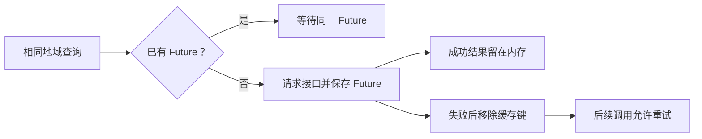

# 05 · 数据接口与影院搜索

实现入口：[maoyan_provider.dart](../lib/data/maoyan_provider.dart)、[搜索弹窗](../lib/widgets/cinema_search_dialog.dart)。本章记录代码中的请求与解析约定，不构成对线上接口可用性的实时保证。

## 1. Provider 接口

```dart
abstract interface class ScheduleProvider {
  Future<CinemaSnapshot> fetchCinema(Cinema cinema);
}

abstract interface class CinemaDirectoryProvider {
  Future<List<CityOption>> fetchCities();
  Future<List<DistrictOption>> fetchDistricts(CityOption city);
  Future<List<Cinema>> fetchCinemas({
    required CityOption city,
    required DistrictOption district,
  });
}
```

目录与排片是两个独立接口，允许分别替换。实现类接收可注入的 `http.Client`，便于 MockClient 测试。目前两个类都未提供显式 `dispose/close` 方法，HTTP 客户端生命周期尚未抽象为统一资源管理。

## 2. 四类请求

| 用途 | 方法与 URL 路径 | 查询参数 | 读取的主要字段 |
| --- | --- | --- | --- |
| 城市 | `GET https://m.maoyan.com/dianying/cities.json` | 无 | `cts[].id/nm/py` |
| 行政区 | `GET /ajax/filterCinemas` | `ci=城市ID` | `district.subItems[].id/name/count` |
| 影院 | `GET /ajax/cinemaList` | `day`、`offset`、`limit`、`districtId`、`cityId` | `cinemas[]`、`paging.hasMore` |
| 影院排片 | `GET /mtrade/cinema/cinema/shows.json` | `cinemaId`、`ci`、`userid=`、`channelId=4` | `success`、`data`、`data.movies[]` |

HTTP 成功要求状态码严格为 `200`；没有使用“全部 2xx 都视为有效”的策略。

### 2.1 城市

城市条目过滤 `id > 0` 且名称非空。结果为空时抛出 `ScheduleProviderException`。当前不维护人工补充城市表，也不对城市总数写死断言；城市数量只在历史在线回归脚本中有测试阈值。

### 2.2 行政区

从 `district.subItems` 读取列表，过滤空名称。`cinemaCount` 用于下拉展示，不作为影院分页终止的唯一依据，也不保证与实际本次查询结果数量一致。

代码接受数据源中的特殊行政区，例如 ID `-1`。构造影院时，区 ID 为 `-1` 则将 `district` 文案设为城市名，而不是生成一个真实行政区名称。

### 2.3 影院分页

每页请求 `limit=100`，初始 `offset=0`。日期 `day` 根据设备当前日期生成 `YYYY-MM-DD`。

分页条件是：响应 `paging.hasMore == true` 且当页原始影院数组非空；偏移量按原始数组长度递增。另有 `offset < 2000` 上限以防异常无限分页。

因此，“一次加载本区影院”是一次逻辑加载，可能包含多次 HTTP 请求。单页数少于 100 不是唯一的终止条件，接口的 `hasMore` 仍参与判断。

完成后按影院 ID 去重、按名称排序，再返回不可修改列表。ID 重复时后加入条目覆盖前条目。原始 ID 无效的影院被跳过；名称没有在这一阶段做同等严格的非空过滤。

### 2.4 排片

请求传入影院及城市上下文。`userid` 为空，没有带用户账号登录信息。

快照工厂要求 `success == true` 且 `data` 是对象；随后解析影片、日期和场次。对异常对象类型或缺少必需 ID 的情况，强制转换可能抛错，并经 Provider 转为异常或保留 `FormatException`。

## 3. 请求头与超时

目录请求带：

- `Accept: application/json`。
- 固定的移动 Chrome User-Agent。
- `Referer: https://m.maoyan.com/cinemas`。
- `X-Requested-With: XMLHttpRequest`。

排片请求带相似的移动 UA，并带影院页 Referer、`X-Requested-With: ajax`、`x-ta`、`uuid`、`channelId` 和 `X-Channel-ID`。

`uuid` 由 `Random.secure()` 生成 32 位大写十六进制字符串，是 `MaoyanScheduleProvider` 的 static 字段：同一 Dart isolate 内的实例复用它，重启或不同执行环境不保证相同。它不是读取硬件序列号、手机号或广告 ID。

每次 `_client.get(...)` 使用 12 秒 Dart Future 超时。超时限制调用方等待，不等价于显式关闭或取消底层 HTTP socket。影院分页每页分别计时，没有整次目录加载的全局总时限。

响应通过 `utf8.decode(response.bodyBytes)` 再 JSON 解码，以支持中文内容。

## 4. 目录 Future 缓存

| 缓存 | 键 | 保存内容 |
| --- | --- | --- |
| `_citiesRequest` | 单值 | 城市列表的 Future |
| `_districtRequests` | 城市 ID | 该城市行政区 Future |
| `_cinemaRequests` | `城市ID:区ID` | 该区影院列表 Future |

缓存的是 Future，因此同时发起相同查询时可以复用进行中的请求，而不仅是成功后的结果。失败处理会删除对应 Future，后续调用可再次尝试。



缓存仅在 Provider 实例生命期内有效。主页面创建一次目录 Provider，并传给重复打开的弹窗，所以搜索弹窗之间可以共享缓存；页面销毁或进程结束后缓存消失。

当前无 TTL、LRU、后台更新或磁盘目录缓存。跨日继续使用同一个实例，影院列表不会仅因日期变化自动失效；大量访问不同地域会让内存缓存持续增长。

## 5. 城市搜索

`CityOption.searchText` 为 `'$name $pinyin $id'.toLowerCase()`。SearchDelegate 对去除首尾空白后的 query 做小写子串匹配，最多 `take(100)` 个结果。

可按城市中文、接口提供的拼音或数字 ID 子串找到城市，但没有内置城市别名纠错、首字母索引或行政区标准化库。前 100 条展示上限不意味着只下载了 100 个城市；输入更具体关键词可筛出其他条目。

城市列表加载成功后优先选中 ID `10`（上海），并加载其行政区；若返回列表没有上海，保持未选择城市。不会自动选区并加载该区影院。

## 6. 影院搜索算法

`fuzzyFilterCinemas` 按以下顺序工作：

1. query 去首尾空白，按一个或多个空白切成若干关键词。
2. 每个关键词转换为小写，去除代码列出的空白、连字符、括号及常见中文/英文标点。
3. 将影院名称和地址连接，按相同规则归一化。
4. 要求所有关键词都包含在影院名称/地址文本中，即 AND 匹配。
5. 以影院名称是否以前一个首关键词开头优先排序，其余按名称比较。

例：`movie 前滩` 可同时约束英文品牌和商圈文本。`MOViE MOViE（前滩）` 与不同大小写、括号形态的搜索可以匹配。算法不自动给中文影院名生成拼音，也不容忍任意拼写错误。

query 为空时直接返回原列表。输入变动只运行本地过滤和 `setState`，不会触发影院接口请求，因此不需要网络级 debounce 来节流。

## 7. 弹窗异步状态保护

- 切城市后清空原区、影院、选中项和搜索文本。
- 行政区请求成功/失败时检查当前城市仍与请求参数一致。
- 影院请求成功时检查当前城市和行政区仍匹配。
- 多处检查 `mounted`，避免页面已销毁时更新 Widget。

现有缺口：影院加载的异常分支只检查 `mounted`，未像成功分支一样核对请求的城市和行政区。旧地域请求失败可能覆盖后来选择的错误/loading 状态；这是待修复竞态，不应写成已经全面隔离过期请求。

## 8. 接口故障策略

当前有状态码检查、解码异常和超时；没有验证码处理、代理池、自动换账号、指数退避、限流器或备用数据源。目录失败可通过后续查询重新调用；排片由手动/周期刷新再次尝试。

接口有变更时，应先保存脱敏响应样本并定位具体字段，再改 Provider/模型并补测试。不能因返回空或解析错误就断言影院未安排排片。

## 9. 扩展接缝

新数据源实现上述两个接口即可接入现有调用链，但 ID 命名空间、影片映射和序列化必须同步设计；当前订阅 key 不含 provider 名称，直接混合不同来源的影院 ID 会有冲突风险。
