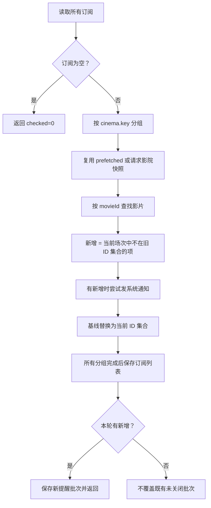

# 07 · 订阅检测与刷新调度

实现入口：[AppController](../lib/app_controller.dart)、[SubscriptionMonitor](../lib/services/subscription_monitor.dart)、[BackgroundMonitor](../lib/services/background_monitor.dart)。

## 1. 订阅创建

`toggleSubscription(movie)` 按影院 key 与影片 ID 搜索已有项。

不存在时：申请通知权限 → 基于当前影片场次创建订阅 → 保存订阅列表 → 尝试 macOS 登录项 → 同步 Android 后台任务 → 更新后台状态与计时器 → 通知 UI。

基线是订阅时已经看到的全部场次 ID，创建时间和初始检查时间都取当前时间。因此不会将目前所有排片立即作为“新增”通知。

存在时删除该项并保存，同步后台任务。返回 bool 表示是否为新增订阅，供页面决定是否弹后台权限引导。

通知权限即使被拒绝，控制器也没有按 false 返回值中止订阅创建；后续仍可在应用内看提醒。不过权限请求若直接抛出未捕获异常，当前创建流程仍可能被打断。

## 2. 订阅删除与跳转

- 侧边栏删除经过确认弹窗，再调用 `deleteSubscription`。
- 删除最后一项会使 Android `syncSchedule` 取消唯一周期任务。
- 当前删除不会同时删除已有提醒批次或取消已发出的系统通知。
- `openSubscription` 负责跳到影院和影片，不会自动重新创建被删除的订阅。
- 顶部提醒中保存了订阅上下文，删除订阅后旧提醒仍可能可点击，这是查看排片行为，不等于重新订阅。

## 3. 差量检测步骤



对应数学表达为：

```text
added(t) = currentSessions(t) 中 id ∉ seenIds(t-1) 的场次
seenIds(t) = 当前响应中该影片的所有场次 ID
```

`detectNewSessions` 保留输入列表顺序，没有在通知前额外做时间排序。UI 的排片排序不改变底层订阅比较逻辑。

## 4. 基线案例

| 旧基线 | 当前响应 | 检测结果 | 新基线 |
| --- | --- | --- | --- |
| A、B | A、B、C | 提醒 C | A、B、C |
| A、B、C | B、C | 无新增 | B、C |
| B、C | A、B、C | 再次提醒 A | A、B、C |
| A、B | 影片不存在 | 无新增 | 空 |
| 空 | A、B | 提醒 A、B | A、B |
| A | ID 仍为 A，时间改变 | 无新增 | A |

基线不是永久历史集合。当前也不检查新增场次是否已开场、是否可购、是否符合用户当前影厅筛选。影厅筛选仅影响浏览，不约束订阅。

## 5. 按影院聚合与快照复用

检测器创建 `byCinema`，同影院的多部电影只查询一次；在快照内建立 `movieId → MovieSchedule` 映射，再逐订阅比较。

前台 `_scheduledRefresh` 先刷新当前影院。若刷新无错误且有快照，传入 `prefetched`，使该影院订阅复用刚获取的数据。其他订阅影院仍逐个查询。

当当前影院刷新失败，旧快照虽仍在 UI 内，但不会传给检测器复用；检测器会为该影院重新请求。一次“立即刷新”操作因此在失败情况下可能出现第二次相同影院请求。

## 6. 前台计时器

`foregroundRefreshInterval` 固定为 3 分钟。定时回调调用 `_scheduledRefresh`：

1. 若 `_scheduledRefreshRunning` 为 true，跳过本轮。
2. 调用 `refresh()` 更新当前影院。
3. 调用 `_checkSubscriptions()` 检查订阅。
4. 在 finally 中释放运行标记。

该标记只防同一控制器的调度刷新重叠；`refresh()` 另有 `loading` 标记阻止重复当前影院刷新。二者都不是跨 isolate 的全局锁，也不覆盖所有快速切换影院的竞态。

即使没有订阅，前台仍按 3 分钟刷新当前影院；“无订阅取消后台任务”不等于前台停止排片刷新。

## 7. 生命周期规则

| 生命周期 | Android | macOS | HarmonyOS |
| --- | --- | --- | --- |
| null / resumed | 启动 3 分钟 Timer | 启动 3 分钟 Timer | 启动 3 分钟 Timer |
| inactive / hidden / paused | 取消页面 Timer | 有订阅时按所选间隔 Timer，无订阅则取消 | 取消页面 Timer |
| detached | 取消 Timer | 取消 Timer | 取消 Timer |

`didChangeAppLifecycleState(resumed)` 额外调用 `reloadNewSessionAlert()` 和 `refreshBackgroundAccessStatus()`。当前回调**不直接执行排片刷新或订阅检查**；下一次 Timer 触发或用户点击“立即刷新”才请求排片。

冷启动 `initialize()` 则会主动执行 `refresh + _checkSubscriptions`。应区分“重新启动应用”和“已运行应用恢复前台”。原有部分提示文案写“立即补查”，比实现更强，是已记录的文案/实现差异。

## 8. macOS 的后台含义

关闭窗口后进程不主动退出，生命周期不是 resumed 且有订阅时，控制器使用选择的后台间隔。

后台 Timer 仍调用 `_scheduledRefresh`，它会先查询当前浏览影院，即使该影院没有订阅。因此 macOS 后台请求数不总等于订阅影院数；不是一个只查询订阅、完全独立于 UI 当前影院的调度器。

从侧边栏删除最后一个订阅的 `deleteSubscription` 不立即重配 Timer；已有 macOS 后台 Timer 可能持续到下一次生命周期变化或其他重配调用。`toggleSubscription` 路径则会重配。这是当前实现的边缘差异。

## 9. Android 周期任务

| 参数 | 值 |
| --- | --- |
| 唯一名 | `cinema_schedule_monitor_v1` |
| 任务名 | `cinema_schedule_subscription_check` |
| 注册策略 | `ExistingWorkPolicy.replace` |
| 网络约束 | `NetworkType.connected` |
| 电量约束 | `requiresBatteryNotLow: true` |
| 请求周期 | 所选分钟数，低于 15 时提升到 15 |

Worker 通过带 `@pragma('vm:entry-point')` 的 `callbackDispatcher` 初始化绑定与通知插件，然后执行 `SubscriptionMonitor().checkAll()`。成功返回 true，任何未捕获异常返回 false；后续重试行为交给 WorkManager，不应推断为项目配置了某个明确的退避间隔。

注册或设置变更会 replace 同名任务，不会按每部影片创建一个 Worker。Android 后台只检查已存储订阅，不主动刷新当前页面影院。

## 10. 自定义间隔

提供 5、10、15、20、25、30、60、120、180、720、1440 分钟。默认 15；不支持的保存值回退 15。

设置变化后：更新内存 → 通知 UI → 保存分钟数 → 同步 Android Worker → 根据当前生命周期重配 Timer。保存的选项不是系统实际执行时间的保证。

## 11. 失败传播与保证范围

通知发送异常会被逐条捕获，因此通知失败不阻止后续基线/提醒保存。HTTP、模型、存储等异常没有逐影院隔离：中途一个影院失败会终止整个 `checkAll`，后续分组不执行。

保存订阅发生在处理所有分组之后。若某影院已发出系统通知、后续影院请求失败，前面的基线未必已落盘，下一次可能重复通知。

没有 exactly-once 投递保证、持久化任务事务或全局互斥。可靠性改进见 [第 11 章](11-Performance-and-Reliability.md) 和 [第 14 章](14-Extension-and-Technical-Debt.md)。
