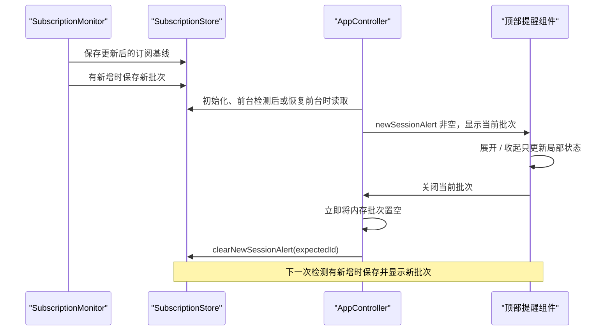

# 08 · 系统通知与应用内顶部提醒

实现入口：[通知服务](../lib/services/notification_service.dart)、[顶部提醒组件](../lib/app.dart)、[日期格式化](../lib/utils/session_date_format.dart)、[批次存储](../lib/data/subscription_store.dart)。

## 1. 两条提醒路径

检测到新增后会尝试系统通知，并在本轮处理成功后保存应用内提醒批次。二者都基于同一组 `NewSessionNotice`，但投递并非原子事务。

系统通知失败时检测器捕获异常，仍继续保存基线和顶部批次。系统通知成功而后续存储或其他影院失败时，则可能没有成功保存当前批次。

应用内提醒是页面 SafeArea 顶部的一张固定区域卡片，不是全系统悬浮窗。没有申请 Android 悬浮窗覆盖权限，也不会覆盖其他 App 界面。

## 2. 系统通知初始化与权限

启动使用 `FlutterLocalNotificationsPlugin.initialize`。macOS 的初始化设置明确不立即申请 alert、badge、sound 权限；实际订阅时再通过 `requestPermissions()` 请求。

权限按平台分派：Android `requestNotificationsPermission`，macOS `requestPermissions(alert: true, badge: true, sound: true)`，鸿蒙插件 `requestNotificationsPermission`。

通知是否启用的查询目前只实现 Android 和鸿蒙，macOS 返回 null。后台状态卡不能因此认定 macOS 已获得通知授权；它主要反映登录项状态。

## 3. 系统通知内容

标题：

```text
{影片名} 新增 {本次新增数量} 个场次
```

正文：

```text
{影院名}｜{日期 周几 时间 影厅}；{下一场}；{再下一场}
```

`buildNewSessionNotificationPreview` 最多取前三个场次，按检测器传入顺序，不强制重新排序。不在系统通知正文里展示所有新增场次、语言/版本详情，也没有本项目配置的通知展开大文本样式。

通知 ID 为 `subscription.key.hashCode & 0x7fffffff`，payload 为订阅 key。相同 key 在同一执行环境通常对应同一 ID，可能更新/覆盖旧通知；不能将 Dart `hashCode` 当成跨进程永远稳定且完全无碰撞的业务 ID。

### 平台配置

| 平台 | 配置 |
| --- | --- |
| Android | channel ID `schedule_changes`、名称“排片变更”，high importance / priority |
| macOS | `presentAlert: true`、`presentSound: true` |
| HarmonyOS | 内容信息 slot，high importance |

系统设置、免打扰、用户禁用通知等仍可影响最终展示。

## 4. 通知点击的边界

当前传入了 payload，但没有配置 `onDidReceiveNotificationResponse` 或冷启动通知路由解析。不能承诺“点击系统通知就自动选中对应影院/影片”。

应用内的“查看完整排片”和场次按钮具有明确跳转实现；系统通知导航若要达到同等体验，需要新增初始化回调和启动参数处理。

## 5. 日期与周几

`formatSessionDate(source, short:)`：

1. 用 `DateTime.tryParse(source)`。
2. 成功时按 `DateTime.weekday`（1 到 7）映射周一至周日。
3. 长格式含年，短格式只含月日。
4. 解析失败时返回原字符串，避免直接崩溃。

| 调用 | 示例 |
| --- | --- |
| 长格式，系统通知 | `2026年8月16日 周日` |
| 短格式，顶部提醒 | `8月16日 周日` |
| 无法解析 | 原文，如 `待定` |

输入预期为电影排片日期，而不是任意含时区的时间戳。当前不进行中国时区转换或联网校时。

## 6. 顶部批次的生命周期



只保存最近一个未关闭批次：

- 本轮没有新增，不覆盖旧批次。
- 新批次到来，会替换上一个未关闭批次，不合并成历史消息队列。
- 进程重启后会加载保存的批次。
- Worker 检测的批次不会自动通过状态流推入已显示页面；页面需要之后加载存储。
- 清除应用数据会一并清除提醒与订阅。

## 7. 收起模式

标题显示总新增场次数，按 notice 分别展示影片和影院，提供“查看完整排片”。每条 notice 的场次使用横向 SingleChildScrollView + Row。

单场次按钮显示“猫眼 + 短日期 + 周几 + 时间 + 影厅”。仅 `canBuy` 为 true 时可打开具体猫眼场次网页。

收起模式外层仍有一个纵向 SingleChildScrollView，以容纳多部影片的 notice 和公共入口；“收起”不代表整个消息区域完全禁止上下滚动。

## 8. 展开模式

点击 tooltip 为“展开场次信息”的按钮，State 中 `expanded` 从 false 切换为 true：

- 场次不再横向 Row 排列，而变为外层纵向滚动中的明细 Tile。
- 每条展示日期、周几、时间、语言、制式、影厅和状态。
- 可购项显示外部跳转图标，点击整个 Tile 打开具体猫眼网页。
- 状态不可购时保留信息展示，禁用购票点击。
- tooltip 改为“收起场次信息”，再次点击恢复横向浏览。

批次 ID 变化时 `didUpdateWidget` 把 expanded 重置为 false；新消息不会沿用旧批次的展开状态。该状态不写磁盘。

## 9. 高度和布局参数

| 模式 | 高度比例 | 约束范围 |
| --- | --- | --- |
| 收起 | 屏幕高度 × 0.42 | 240～420 |
| 展开 | 屏幕高度 × 0.68 | 360～680 |

这些是 `maxHeight` 的计算，不是保证填满该高度。消息内容较少时可以更矮。标题和关闭按钮位于内容滚动区域之外。

极低窗口高度、大字号和大量 notice 需要额外布局验证。当前以 Column 展开所有场次，没有虚拟化成按需构建的 ListView。

## 10. “关闭”的准确含义

关闭按钮调用控制器清空当前内存批次，然后使用 expectedId 尝试删除存储。它：

- 不删除订阅。
- 不重置已见场次 ID。
- 不清除所有未来通知。
- 不取消系统通知插件已展示的通知。
- 不保存一个永久的“不再显示提醒”开关。

如果另一个执行环境同时写入消息，expectedId 检查只能降低误删概率，不提供数据库级的原子条件删除。

## 11. 提醒内的购票入口

公共按钮包括猫眼 App、淘票票 App、淘票票网页；具体场次按钮指向猫眼网页。支付宝入口位于普通场次卡的购票弹层，不出现在顶部公共按钮组。

“查看完整排片”调用 `openNewSessionNotice`，委托 `openSubscription`。它切换视图，不会自动关闭当前提醒批次，也不会重新创建一个订阅。

## 12. 后续可补能力

通知点击定位、稳定通知 ID、跨 isolate 事件同步、多个未读批次队列和分批列表虚拟化尚未完成。方案见第 14 章，不应据此向用户承诺已存在这些功能。
