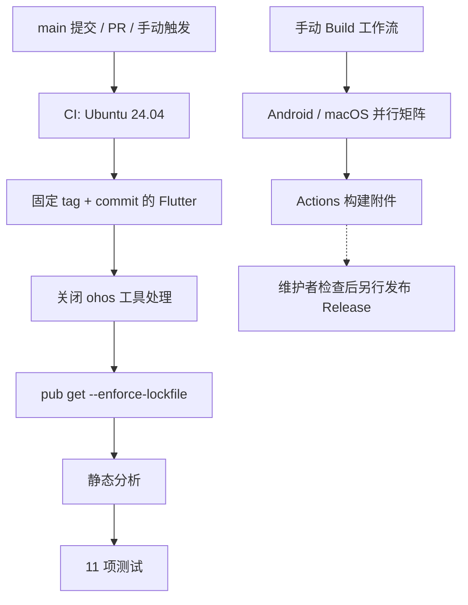

# 12 · 环境、构建、CI 与发布

快速命令见 [既有构建指南](../docs/BUILDING.md)。本章说明每一步对应的实现和容易混淆的边界。

## 1. 固定工具链

| 工具/配置 | 本版基线 |
| --- | --- |
| Flutter | OpenHarmony-SIG `3.41.10-ohos-1.0.0` |
| Flutter commit | `244a0e8abb3085e8675589b13e219af8c41cb7aa` |
| Dart | 该 Flutter 自带 `3.11.5` |
| Java | JDK 17 |
| Gradle | 8.9，Wrapper 固定 |
| AGP | 8.7.3 |
| Kotlin 插件 | 2.1.0 |
| Android compile SDK | 36 |
| Android min/target | 跟随该固定 Flutter 的值；本版 APK 为 24 / 36 |
| macOS 部署下限 | 10.15；登录项能力需 13+ |

`pubspec.yaml` SDK 范围比实际验证版本宽，不应据此推断任意 Dart 3.6/旧 Flutter 均可编译；ThemeData 等 API 已按 Flutter 3.41 适配。

## 2. 为什么既固定 tag 又固定 commit

CI 从 GitCode 获取 Flutter tag，并检查 checkout 后的 HEAD 等于固定 SHA。tag 为 Flutter 工具提供可识别的版本元数据，SHA 保证具体源码不随标签/分支变化而悄悄变化。

只拉取一个无 tag 的裸提交可能导致工具显示未知版本；只跟随分支则不能复现本版环境。

SDK 的初始化和 `.github/actions/setup-flutter/action.yml` 都不应包含用户本机绝对路径。

## 3. 依赖准备

```bash
export PUB_HOSTED_URL=https://pub.flutter-io.cn
export FLUTTER_STORAGE_BASE_URL=https://storage.googleapis.com
flutter config --no-enable-ohos
flutter pub get --enforce-lockfile
flutter analyze --no-pub
flutter test --no-pub --reporter expanded
```

三个 Git 覆盖依赖为 `shared_preferences`、`url_launcher` 和 `flutter_local_notifications` 的鸿蒙适配分支，具体解析 commit 由 `pubspec.lock` 固定。

仅构建 Android/macOS 时关闭 ohos 工具处理，避免仓库保留的 `ohos/` 目录使 `pub get` 随后要求 `HOS_SDK_HOME`。这不会删除鸿蒙源码。需要开发鸿蒙时运行 `flutter config --enable-ohos` 并配置真实 SDK。

`--enforce-lockfile` 用于发现依赖锁不匹配，而不是默默升级依赖。不要为消除“有新版本”提示随意升级并覆盖锁文件。

## 4. Android 构建链

```bash
flutter build apk --release --no-pub
```

Flutter 调用 Gradle assembleRelease。项目的 `copyCinemaRadarReleaseApk` 作为 assembleRelease 的 finalizer，将常规 APK 复制成品牌化文件名：

```text
build/app/outputs/flutter-apk/app-release.apk
build/app/outputs/flutter-apk/CinemaRadar-1.0.3+4.apk
```

命名读取 Flutter 的 versionName/versionCode，来源为 `pubspec.yaml` 或构建命令显式覆盖值。保留常规文件是为了兼容 Flutter 内部工具。

当前 release 使用 `signingConfigs.debug`。它便于本地测试，但不同机器/临时 CI runner 的 debug keystore 通常不同，因此不同构建不保证可相互覆盖安装。稳定升级必须维护同一套持久化 release 密钥。

## 5. macOS 构建脚本

```bash
./tool/build_macos_release.sh
```

脚本使用 zsh，执行顺序为：

1. 解析脚本目录和项目根目录。
2. 从 `pubspec.yaml` 提取完整版本，验证版本格式和目标路径。
3. 运行 `flutter build macos --release`。
4. 检查 `CinemaRadar.app` 存在。
5. 使用 `ditto -c -k --sequesterRsrc --keepParent` 打包。
6. 将临时压缩包移到版本化目标。

输出为 `build/macos/CinemaRadar-1.0.3+4.zip`。当前验证产物包含 arm64/x86_64；以后升级构建配置仍应再次检查，不能只根据脚本名称断言架构。

本机需要完整 Xcode、CocoaPods 和已完成的首次启动/许可配置。当前应用为 ad-hoc 签名、未公证；正式外部分发需要维护者的 Apple Developer ID 与公证流程。

## 6. 两个 Actions 工作流



### CI

触发：main push、Pull Request、workflow_dispatch。运行器固定 ubuntu-24.04，30 分钟超时，同 ref 新运行取消旧运行。

权限仅 `contents: read`，checkout 不持久化凭据。依次执行固定 SDK、锁依赖、analyze、test。即使只修改文档，当前工作流也会运行；未配置 paths 过滤。

### Build Android and macOS

只接受手动触发，矩阵为 Android ubuntu-24.04、macOS macos-14，每项 60 分钟；一个平台失败不会立即取消另一个。

Android 使用 Temurin JDK 17；macOS 调用发布脚本。输出通过 upload-artifact 上传，缺少产物时报错。它没有自动创建 Release、上传到应用商店或使用维护者签名私钥。

## 7. 已发生的 CI 问题

首次公开仓库时，一轮 CI 在依赖解析后因 `No Hmos SDK found` 失败。随后主分支补上 `flutter config --no-enable-ohos` 并通过。

历史失败记录不会因新运行成功而消失，GitHub 也可能发送旧运行的失败通知。排障应核对最新 main 的 SHA、检查结论和时间，而不是只看某封历史邮件。

发布标签 `v1.0.3` 固定在发布时源码；其后的 CI/文档改进位于 main。若下载历史源码包，应同时参考 main 的最新构建说明。不要为了修改 CI 文档而强制移动已发布标签。

## 8. 版本、标签和资产

| 对象 | 示例 |
| --- | --- |
| 应用完整版本 | `1.0.3+4` |
| 用户版本 | `1.0.3` |
| Android versionCode / macOS CFBundleVersion | `4` |
| Git tag | `v1.0.3` |
| APK | `CinemaRadar-1.0.3+4.apk` |
| macOS ZIP | `CinemaRadar-1.0.3+4.zip` |
| 二合一 ZIP | `CinemaRadar-1.0.3+4-android-macos.zip` |
| 校验清单 | `SHA256SUMS-1.0.3+4.txt` |

本轮技术文档提交不重新构建应用，不递增版本，也不覆盖这几个附件。

## 9. 发布前验证

1. 核对源码版本和 CHANGELOG。
2. 执行相关测试和两个 Release 构建。
3. 检查 APK 内部版本/包 ID、macOS plist 版本和双架构。
4. 确认签名是否与上一版本相同，必要时说明升级约束。
5. 生成最终文件 SHA-256，校验二合一包只含目标两文件。
6. 提交发布说明和校验清单，对最终提交建立版本标签。
7. 上传 Release 附件并核对远端 digest/下载链接。

源码由 GitHub tag 自动生成 ZIP/tar.gz，不需将 build 目录纳入版本控制。tag 发布后保持不可变；新的应用变更用新版本发布。

## 10. HarmonyOS 签名脚本

`extract_ohos_signing.mjs` 将本机签名写到已忽略文件并清理公开模板；`merge_ohos_signing.mjs` 在构建时合并。`build_ohos_release.sh` 备份模板、临时合并、构建、选择唯一 signed HAP，结束后通过 trap 恢复模板。

此链路保留于仓库，但本版发布没有运行它。未来重启鸿蒙发布时需重新验证 SDK、插件、原生版本和证书，不应仅改文件名后发布。
