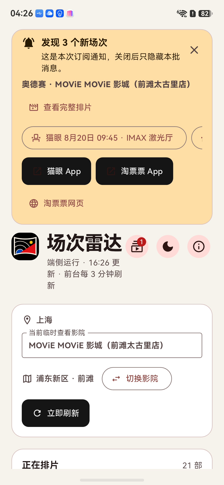
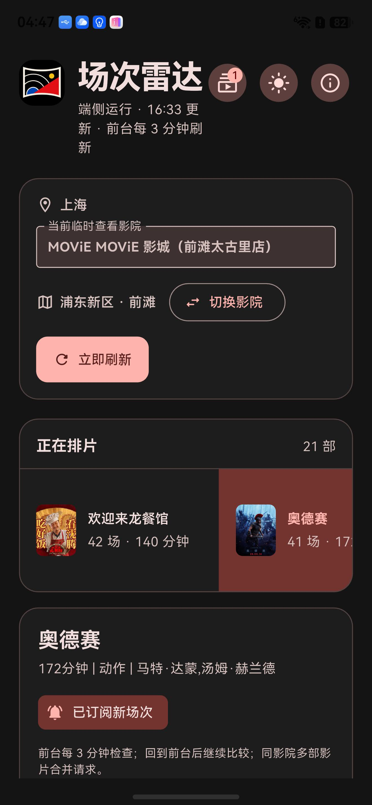

<p align="center">
  
</p>

# CinemaRadar · 场次雷达

为想看的电影守候新场次。按城市、行政区和关键词找到影院，订阅“影院 + 影片”，新增排片时通过系统通知和应用内提醒快速跳转选座。

每台设备独立查询、保存订阅和比较场次，无需部署后端，也无需让电脑保持在线来服务手机。

[](https://github.com/hzxslzb/CinemaRadar/releases/latest)
[](https://github.com/hzxslzb/CinemaRadar/actions/workflows/ci.yml)
[](https://github.com/hzxslzb/CinemaRadar/releases/latest)

[下载安装](#下载安装) · [使用指南](docs/CinemaRadar-用户简介.md) · [更新记录](CHANGELOG.md) · [自行构建](docs/BUILDING.md) · [问题反馈](https://github.com/hzxslzb/CinemaRadar/issues)

## 下载安装

当前版本 **1.0.3（构建 4）**，本次发布 Android 和 macOS。

| 平台 | 下载 | 运行要求 |
| --- | --- | --- |
| Android | [CinemaRadar-1.0.3+4.apk](https://github.com/hzxslzb/CinemaRadar/releases/download/v1.0.3/CinemaRadar-1.0.3%2B4.apk) | Android 7.0 / API 24 及以上 |
| macOS | [CinemaRadar-1.0.3+4.zip](https://github.com/hzxslzb/CinemaRadar/releases/download/v1.0.3/CinemaRadar-1.0.3%2B4.zip) | macOS 10.15 及以上，Apple Silicon / Intel 双架构 |
| 两端合集 | [CinemaRadar-1.0.3+4-android-macos.zip](https://github.com/hzxslzb/CinemaRadar/releases/download/v1.0.3/CinemaRadar-1.0.3%2B4-android-macos.zip) | 包含上述 APK 和 macOS ZIP |

完整附件及校验清单见 [Release 页面](https://github.com/hzxslzb/CinemaRadar/releases/tag/v1.0.3)。

- Android：下载 APK，允许安装当前下载来源的应用后安装；首次订阅时允许通知。
- macOS：解压 ZIP，将 `CinemaRadar.app` 放入“应用程序”后打开。此包为 ad-hoc 签名、未经 Apple 公证；若系统阻止，可在确认下载来源后通过“系统设置 → 隐私与安全性”查看允许打开选项。登录项功能需 macOS 13 及以上。
- 当前 Android 包使用开发调试证书，macOS 包使用 ad-hoc 签名。后续正式签名变化可能影响覆盖升级。

## 能做什么

- **按需查询影院**：城市 → 行政区 → 影院关键词模糊搜索；选中影院后才查询排片，输入关键词不会持续发起网络请求。
- **排片浏览**：按时间升序/降序排列，筛选普通厅、IMAX、Dolby 及其他特效厅。
- **精准订阅**：订阅某家影院的某部电影，仅对新增场次提醒；侧边栏可删除订阅或直接返回对应排片。
- **双重提醒**：系统通知和应用顶部消息同步显示日期、周几；顶部消息可展开/收起，展开后上下滚动查看时间、语言、版本、影厅及购票状态。关闭只隐藏本批，下一批仍会出现。
- **快速购票入口**：指定场次跳转猫眼网页选座，另有猫眼 App、淘票票 App/支付宝和网页入口。
- **端侧运行**：前台每 3 分钟刷新；后台间隔可选 5/10/15/20/25/30 分钟和 1/2/3/12/24 小时，同影院多部订阅合并请求。
- **浅色/深色主题**：日月按钮切换，并记住本机偏好。

## 界面预览

<p align="center">
  
  
  
</p>

截图来自早期鸿蒙真机回归，用于展示整体界面；`1.0.3` 新增了周几与提醒展开按钮，Android/macOS 的系统设置入口略有不同。

## 三步开始

1. 点击“切换影院”，选择城市、行政区，输入关键词并选中影院。
2. 选择目标影片，浏览或筛选场次，点击“订阅新场次”。
3. 允许通知，并按侧边栏“后台设置”提示完成系统设置；发现新增场次后从通知或顶部提醒进入排片与购票页面。

订阅和偏好只保存在当前设备，不在设备之间同步。

## 后台运行

| 平台 | 当前行为 |
| --- | --- |
| Android | 有订阅时使用 WorkManager 周期检查，要求联网且电量不低；系统最短周期 15 分钟，选择 5/10 分钟时按 15 分钟调度。提供通知及电池优化设置引导。 |
| macOS | 关闭最后一个窗口后进程继续运行，并按所选间隔检查订阅；尝试注册登录项并提供设置跳转。主动退出、关机或系统休眠期间不会继续检查。 |
| HarmonyOS | 仓库保留平台源码；本次没有 HAP。此前版本使用前台刷新和回前台补查，不保证后台常驻。 |

系统省电、网络状态和任务调度可能延迟提醒。应用不承诺精确到秒或永久后台常驻。

## 数据与购票

当前通过猫眼移动网页所使用的定向影院接口读取排片；该接口不是承诺对第三方长期开放的开发者 API，可能发生变更、限流或不可用。

应用目前提供购票跳转。淘票票需要用户重新确认其平台内的影片、影院和场次；直接锁座、支付、出票需要授权的票务接口及安全服务端，当前未接入。排片、价格、座位和订单状态以票务平台最终页面为准。

详细接口研究、授权接入方向及来源链接见 [数据源研究与实现说明](docs/DATA_SOURCES.md)。

## 开发

项目使用 Flutter / Dart，固定的开发 SDK 为 OpenHarmony-SIG Flutter `3.41.10-ohos-1.0.0`，提交 `244a0e8abb3085e8675589b13e219af8c41cb7aa`。保留 HarmonyOS 适配插件的 Git 依赖，并通过 `pubspec.lock` 固定解析版本。

```bash
flutter config --no-enable-ohos
flutter pub get --enforce-lockfile
flutter analyze --no-pub
flutter test --no-pub
```

环境安装、Android/macOS 打包、签名和 CI 操作见 [构建说明](docs/BUILDING.md)。GitHub Actions 自动检查代码与测试；“Build Android and macOS”工作流可手动生成两端构建附件。

```text
lib/          页面、端侧数据源、订阅和通知逻辑
android/      Android 原生入口与后台设置桥接
macos/        macOS 原生入口、登录项与应用配置
ohos/         保留的 HarmonyOS 平台源码
test/         数据解析、订阅与界面回归测试
tool/         发布构建、在线回归及本地签名处理脚本
docs/         使用指南、截图、数据源研究及版本说明
```

完整源码随仓库上传；本地签名、凭据、SDK 路径、IDE 状态和编译缓存被排除，二进制安装包放在 Release 附件中。

欢迎通过 [Issues](https://github.com/hzxslzb/CinemaRadar/issues) 反馈问题，参与开发前请阅读 [贡献指南](CONTRIBUTING.md)。本仓库尚未指定开源许可证；第三方依赖、商标与电影素材的权利归各自权利人。
