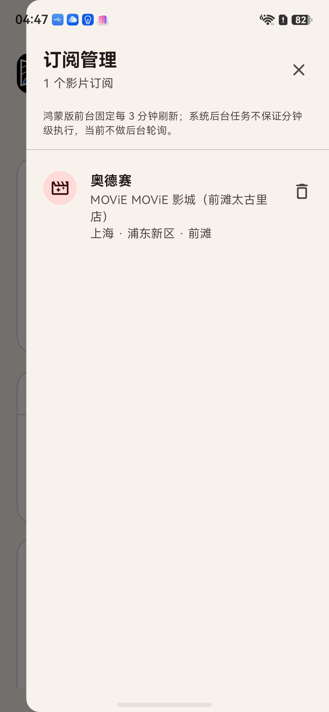
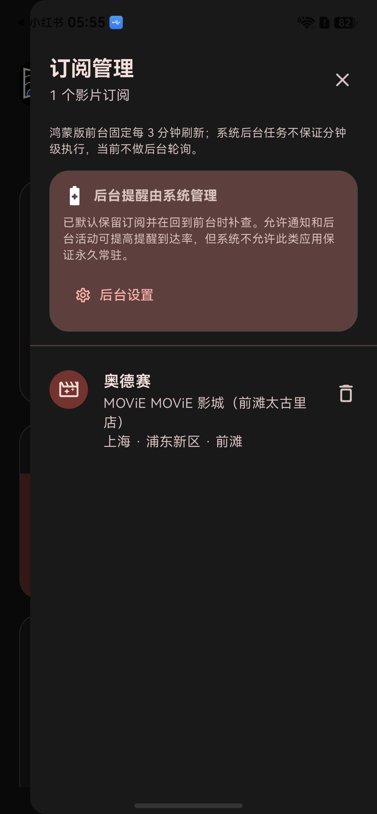

# CinemaRadar · 场次雷达

CinemaRadar 是一款影院排片查询与新场次提醒工具。选好城市、行政区和影院后，即可查看当前排片；订阅感兴趣的影片后，应用会在发现新场次时及时提醒你。

  

## 主要功能

- **搜索与切换影院**：按城市和行政区缩小范围，再用关键词模糊搜索影院，无需输入影院 ID。
- **查看实时排片**：只在选中具体影院后加载排片，支持按时间排序，也可筛选普通厅、IMAX、Dolby 及其他特效厅。
- **订阅新场次**：选中“影院 + 影片”即可订阅。前台每 3 分钟自动检查，只对比订阅所需数据，不会全城高频扫描。
- **双重新场次提醒**：系统通知和应用顶部提醒都会显示日期与周几。顶部提醒可展开/收起；展开后能上下滑动查看语言、版本、影厅及购票状态。关闭只隐藏当前这一批，下次有新场次仍会再次提醒。
- **快速跳转购票**：可从新场次提醒或排片页快速打开猫眼 App/网页，也提供淘票票 App/网页入口。
- **订阅管理**：点击页面右上角的订阅图标，可查看、删除订阅，或直接回到对应影院和影片的排片页。
- **后台提醒引导**：订阅时默认开启后台提醒能力。通知未授权或受系统省电策略限制时，应用会提示并提供“后台设置”入口。
- **浅色/深色主题**：点击日月图标即可切换，应用会记住你的选择。

## 新场次提醒

  

顶部提醒会列出本次发现的新场次及周几。收起时可左右滑动快速浏览；点击展开后改为上下滑动并展示更多排片信息，也可直接查看完整排片或跳转猫眼、淘票票继续选座购票。

## 管理订阅与主题

  
  &nbsp;&nbsp;
  

## 后台提醒设置

  

订阅侧边栏会显示当前平台的后台提醒状态。如果还需要完善权限，点击“允许通知”或“后台设置”，按系统页面的提示完成设置即可。

## 三步开始使用

1. 点击“切换影院”，选择城市和行政区，搜索并选中影院。
2. 在正在排片的影片中选择目标影片，查看日期、时间、影厅和版本信息。
3. 点击“订阅新场次”，之后的新增排片就会进入提醒流程。

## 使用说明

CinemaRadar 支持 Android、macOS 和 HarmonyOS，每台设备都独立运行，订阅与偏好只保存在当前设备，不需要将电脑作为后端。

Android 会在订阅后默认安排低开销周期后台检查；通知或省电策略权限不足时，可按应用弹窗进入系统设置。macOS 关闭最后一个窗口后仍会按选定间隔检查订阅，有订阅时会尝试注册“登录时打开”，需要用户确认时可从“后台设置”直达系统登录项页面。

鸿蒙手机不允许这类排片工具保证永久常驻。重新启动应用时会检查排片；已运行的应用从后台回到前台后恢复周期检查，也可以点击“立即刷新”。可通过应用内的“后台设置”直达系统应用详情页，确认通知和应用联网权限。

后台刷新仍受操作系统的省电策略、网络状态和后台任务调度影响，提醒属于“尽快到达”，不保证精确到秒。排片、票价、座位与最终订单状态以猫眼、淘票票或影院官方页面为准。

开发者可阅读 [Doc/ 技术文档中心](../Doc/README.md)，了解架构、数据接口、订阅和通知的具体实现及现有边界。
